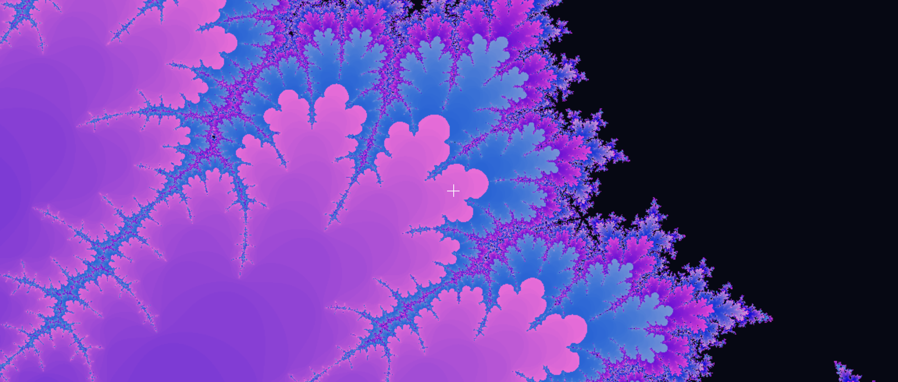
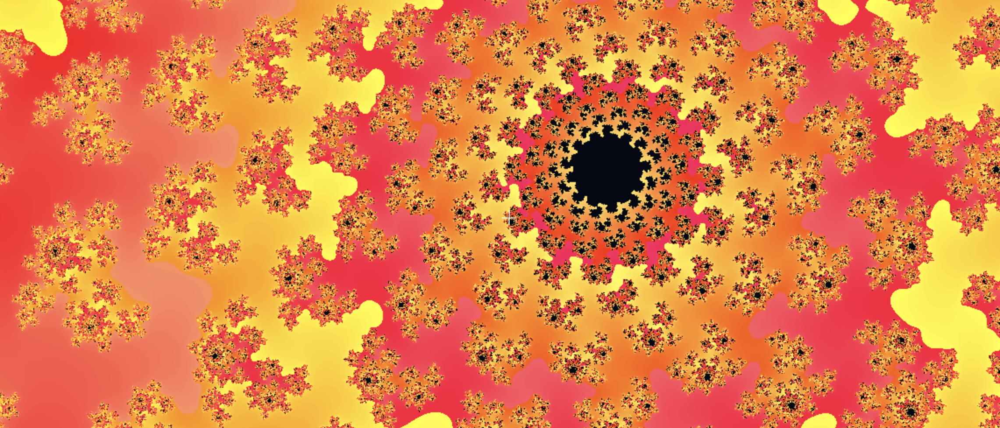
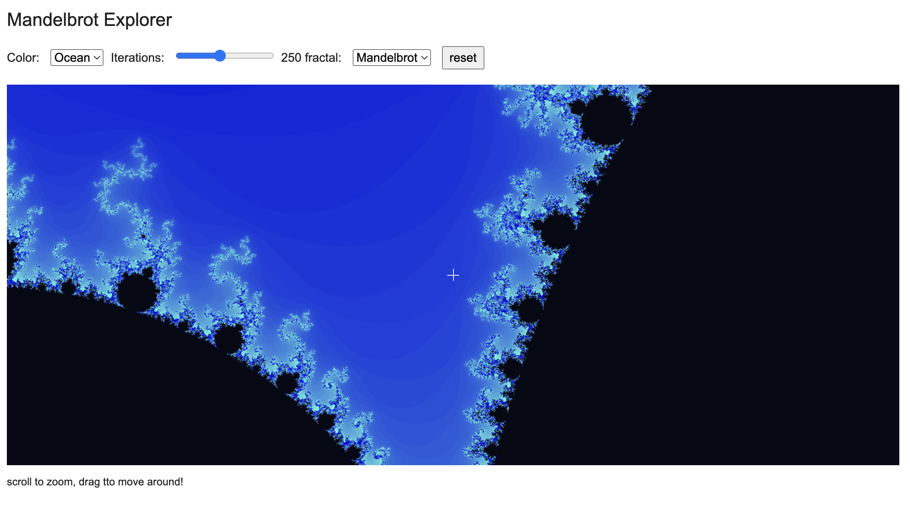

# fractal

This is a simple Mandelbrot / Julia fractal explorer.
It's my first time to make a fractal, but it went pretty good.

The UI is simple because I wanted to do it in a short time (not to delay my other project).

## screenshots

**Mandelbrot mode:**

**Julia mode (with controllable parameters)**

**Overall UI and website look:**

## others (for reviewers)
The contributor name "zubeiyang" is myself, it's because I'm using my mom's laptop. I'm too lazy to set my github account up in her laptop, sorry :)

